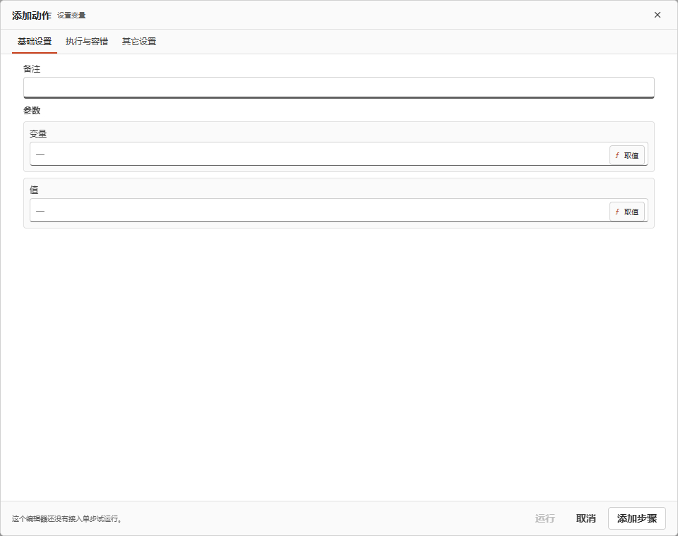
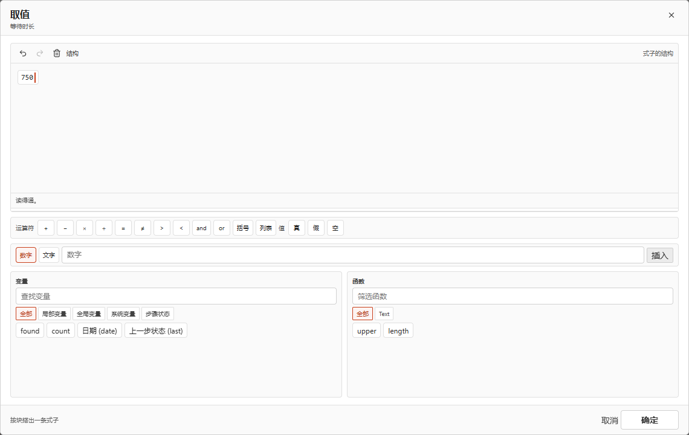

# WhaleGenie 视觉契约

本文件是 WhaleGenie（鲸灵）全部界面的视觉契约。它回答“应该长什么样、什么算完成”，不记录实现
历史，也不复制令牌值。实现结构与资源分层见 [docs/architecture/interface.md](docs/architecture/interface.md)，
具体颜色、字号、间距与圆角值以 [Tokens.axaml](src/WhaleGenie/Themes/Tokens.axaml) 为准；自定义强调色由
`ThemePalette` 在运行时派生并覆盖这组强调令牌，是唯一的例外。

界面正在迁移到网页壳（见第 14 节）：迁移期间第 1–13 节管原生窗口，第 14 节管网页壳；一个区域
迁入网页时，它的原生契约条目随旧实现同版删除，最终本文件只剩第 14 节。

本文件对照 FluentAvalonia 3.1.0 的 [FluentAvaloniaTheme](https://amwx.github.io/FluentAvaloniaDocs/pages/FATheme)、
[AppWindow](https://amwx.github.io/FluentAvaloniaDocs/pages/Controls/AppWindow)、
[SettingsExpander](https://amwx.github.io/FluentAvaloniaDocs/pages/Controls/SettingsExpander) 与
[NumberBox](https://amwx.github.io/FluentAvaloniaDocs/pages/Controls/NumberBox) 文档校对；文档解释库行为，
项目采用什么、长什么样仍以本文件与 `Themes/` 为准。

## 1. 契约与优先级

- **视觉意图与规则以本文件为准**；值以 `src/WhaleGenie/Themes/` 下的令牌与样式为准；实现结构以架构文档为准。
- 优先级从高到低：本文件的规则 → 项目令牌与控件样式 → FluentAvalonia/Avalonia 的默认外观。
- 库的默认值是底座，不是契约。库默认与项目令牌冲突时，修项目实现，不用库默认覆盖契约。
- `avalonia-docs` MCP 只解释 Avalonia/FluentAvalonia 的 API、控件和属性；它不能替代本文件，也不能
  成为新增颜色、字号或间距的依据。外部文档示例不能直接粘贴成项目样式。
- 视觉决定、令牌、控件样式与验收测试在同一轮完成；只改 XAML 或只改文档都不算完成。

## 2. 视觉基调

- Windows 桌面工具，游戏与办公同等重要：信息密度优先于装饰，扫读优先于表演。
- 中性表面承载内容，**只有一个强调色家族**；成功、警告、危险、信息只用于表达状态，不用于装饰。
- 深色是默认体验，浅色必须同等可读；自定义强调色是同一套语义令牌的替换，不是第二套主题。
- 中文与英文界面共用同一套度量；文字变长时优先换行或增高，不挤压控件、不裁字。
- 图标、圆角、边框和叠层服从既有令牌与 Fluent 控件族；不引入第二套图标语言或装饰性渐变。

## 3. 资源层级

| 层 | 文件 | 契约 |
| --- | --- | --- |
| 语义令牌 | `Tokens.axaml` | 颜色、字体、字号、间距、内边距、圆角的默认值只有这一处；自定义强调色运行时覆盖 |
| Fluent 资源键 | `FluentKeys.axaml` | 只把 Fluent 模板会读取的键映射到项目令牌 |
| 控件类与模板 | `Controls.axaml` | 只补 Fluent 缺的模板、状态与项目控件类 |

- 不在窗口、视图或局部样式里另建颜色体系；不用十六进制，也不用 `Brushes.*` 表示项目颜色
  （`Transparent` 这类无值常量除外），这些都必须走令牌。
- `FluentAvaloniaTheme` 是主题管理者：它提供 Fluent v2 控件样式、Light/Dark/HighContrast 变体和
  `SystemAccentColor` 家族；项目只引入它，不同时引入 `FluentTheme` 或 `SimpleTheme`。
- 库的内部资源 `ContentControlThemeFontFamily`、`SystemAccentColor` 与六个变体、
  `SymbolThemeFontFamily` 可以被覆盖；项目覆盖字体族与 `AccentFill` 强调家族，不覆盖符号字体。
- 新的 Fluent 键必须核对当前库版本里真实存在；写错键不会报错，只会静默退回库默认。
- 能由 `FluentKeys.axaml` 改掉的，不写进 `Controls.axaml`；层 3 只处理层 1 表达不了的部分。
- 资源键和样式类改名时，同步检索 XAML、代码与测试中的旧引用。

## 4. 颜色角色

- **表面**：`SurfaceWindow`、`SurfaceChrome`、`SurfaceSunken`、`SurfacePanel`、`SurfaceField`、
  `SurfaceCard`、`SurfaceFlyout`、`SurfaceHover`、`SurfacePressed`、`SurfaceControl` 及其
  悬停/按下变体。层级用表面区分，不靠阴影堆叠。
- **文字**：`TextPrimary`、`TextSecondary`、`TextTertiary`、`TextDisabled`、`TextOnAccent`。
  正文用 Primary，说明与次要信息用 Secondary/Tertiary，禁用态才用 Disabled。浮层里的正文也要显式
  取 `TextPrimary`，不靠继承或控件默认色——浮层是独立顶层，继承链不可控。
- **边框与焦点**：`BorderSubtle`、`BorderControl`、`BorderControlHover`、`BorderStrong`、
  `FocusRing`。焦点必须可见，不能只靠悬停色暗示。
- **强调**：`AccentFill` 家族（Fill/Hover/Pressed/Text/Surface）。一个界面只有一个强调色家族；
  自定义强调色必须通过 `ThemePalette` 的对比度底线，不能为了“好看”牺牲可读性。
- Fluent v2 的强调资源是 `SystemAccentColor` 加 Light1–3、Dark1–3 共七个；项目
  `FluentKeys.axaml` 目前映射 Light1/2 与 Dark1/2，未映射 Light3/Dark3。新增控件若读取后两键，
  先补映射，不能假设自定义强调色已经覆盖。
- 不使用 `FluentAvaloniaTheme.CustomAccentColor` 或 `PreferUserAccentColor`：库不会替调用方做
  可访问性检查。项目关闭系统用户强调色，由 `ThemePalette` 派生五个 `Accent*` 令牌并执行
  4.5:1 底线。
- **状态**：`Success`、`Warning`、`Danger`、`Info` 及对应 Surface。状态色用于状态，不用于装饰；
  紧凑状态点（如宏卡片圆点）必须在其操作入口或提示里给出等价文字，新增状态不要只靠颜色。
- **叠层**：`OverlayHover`、`OverlayPressed` 用于任意表面上的半透明交互反馈；不要为“不画”
  新建令牌。
- **拾取器**：框选、取色、点、元素、窗口规则五个窗口的遮罩令牌不随明暗变化；它们读取的是屏幕像素，
  不能因为主题切换而改变读数。

## 5. 字体与密度

- 正文使用 `UiFont`；代码、表达式和需要等宽的内容使用 `UiCodeFont`，不用等宽字体做普通界面字。
- 字号/行高只使用 `UiCaption`、`UiBodySmall`、`UiBody`、`UiSubtitle`、`UiTitle`、`UiDisplay`
  这组角色（每档对应 `*Size` / `*Line` 两个令牌）；不新增“差不多大”的字号档。字号与行高必须成对
  取同一档，说明浮层正文是 `UiBodySmall`（12 / 16）。
- 密度沿用 Fluent v2 的默认密度；FluentAvaloniaTheme 没有单独的密度开关，表格行、列表项、
  菜单项随库样式走，不为了“紧凑”再手写一套行高。
- Fluent v2 的基础控件字号是 14（`ControlContentThemeFontSize`）；项目把它映射为 `UiBody` 的
  13，这是有意的桌面密度偏离，不另写第二套字号。
- 字体族由 `FluentKeys.axaml` 的 `ContentControlThemeFontFamily` 映射到 `UiFont`；不要用
  `UseSystemFontOnWindows` 或窗口级 `FontFamily` 替换它。
- 不覆盖 `SymbolThemeFontFamily`；FluentAvalonia 的图标字形依赖它。
- 行高写下限（`MinHeight`），不写定高；两行文字、徽标或换行必须能撑开行而不被裁切。
- 数字输入、计数和需要纵向对齐的表格使用固定列宽并右对齐；不靠空格对齐。

## 6. 间距、内边距与圆角

- 间距使用 `Space1` 至 `Space8`；`StackPanel.Spacing` 使用 `StackGap`（它是 `Double`，
  不能拿 `Thickness` 的 `Space*` 代替）。
- 内边距使用 `Pad*` 族：`PadControl`、`PadField`、`PadCell`、`PadChip`、`PadRow`、
  `PadSection` 等按用途命名，不按数字命名。
- `Gap*` 只用于没有父容器能提供间距的少数位置；新增 `Gap*` 前先说明为什么 `Spacing` 做不到。
- 圆角只用 `RadiusControl`、`RadiusContainer`、`RadiusOverlay` 三个角色。Fluent v2 默认
  `ControlCornerRadius=4`、`OverlayCornerRadius=8`，项目把前者映射到 `RadiusControl`、后者映射到
  `RadiusOverlay`；`RadiusContainer=6` 用于卡片/面板，不另写按钮、输入框的圆角。标题栏上
  与系统 caption 按钮同形的自绘按钮是唯一例外，取直角并贴顶，见第 8 节。
- 列宽、窗口尺寸、图标尺寸等结构尺寸可以单独写；同一模式重复出现时抽成令牌或共享常量，不散落魔法数。
- 行内说明图标：视觉 14×14、命中区 24×24、行高 24，图标与同行文字的间距 6；带图标的行内标签
  不带走 `GapField` 的下边距，普通字段仍保留 8。勾选框与图标同行时按同一 24 行高收敛，不裁字。
  这条对齐只在 `HintInfo` 一处实现，视图里不写逐行 `Margin`。

## 7. 状态与交互

- 每个可交互控件至少要有静息、悬停、按下、禁用和焦点五种可读状态；焦点态必须能在两种主题下看见。
- 树上的折叠钮是**控件**，不是引导线的一部分：实心底（`SurfaceControl`）+ 描边 + 主文字色字形，
  并压在穿过它的那条虚线之上（模板里那一格的层级高于内容列）。树线是虚线，一枚与线同亮度的方块读起来
  就是“线的一部分”，而不是“这里可以折叠”；悬停与按下各换底和边，焦点仍由行的焦点环表达。
- 状态类遵守 `Controls.axaml` 头部的 `STATE` / `VARIANT` / `LAYER1` / `STATIC` 登记：
  不发明新的状态词，新类要么自己画悬停态，要么登记为由层 1 绘制。
- `selected` 表示“当前选中”，`chosen` 表示“已经选好”，`problem` 表示“这里有问题”；
  同名概念只用一个词。
- 禁用不是“把文字调淡就算了”：背景、边框与文字一起退后，但仍要能读出控件是什么。
- FluentAvalonia 控件的状态由伪类（`:pointerover`、`:pressed`、`:disabled`、`:focus-visible` 等）
  和 `ControlTheme` 驱动；项目只通过资源键与 `ControlTheme` 覆盖，不在事件处理里手改颜色。
- 需要重写模板时，按库文档的 `Required Template Parts` 命名取部件，不按视觉树猜名称；模板里的
  悬停、按下、焦点状态仍引用项目令牌。
- 动效只用于解释状态变化（展开、弹出、切换）；不做与操作无关的循环装饰，不遮挡焦点和内容。

## 8. 窗口与浮层

- 普通窗口统一继承 `AppWindow`（`FAAppWindow`）；内容伸入标题栏的窗口统一调用
  `WindowChrome.Attach(this)`，由它画鲸鱼、标题并留出系统按钮宽度，不在窗口里自搭标题栏。
- 标题栏由 `TitleBar` 管理：`ExtendsContentIntoTitleBar`、`Height`、`LeftInset`/`RightInset`、
  `TitleBarHitTestType` 与 `SetDragRectangles` 是库提供的入口。系统按钮宽度由窗口框架统一留出，
  不在每个窗口里重算；把可交互控件放进拖动区时，用 `TitleBarHitTestType` 或自定义拖动矩形解决。
- 标题栏颜色用 `TitleBar.*Color`，不在内容里铺一层假标题栏。`SetWindowBorderColor` 只用于
  Windows 11；任务栏进度只在长任务需要时使用，不把标题栏当状态面板。
- 系统画的 caption 按钮（最小化、最大化、关闭）颜色也由窗口框架交给 `TitleBar`：静息与未激活
  底透明，悬停 `SurfaceControlHover`、按下 `SurfaceControlPressed`，字形 `TextPrimary`，未激活
  字形与激活态同色——标题栏里的鲸鱼与标题是自绘的，本来就不随失活变暗，只压暗三个系统按钮会
  让旁边的置顶钮显得还亮着。关窗红仍是系统语义色，不跟着这组灰走。不设这组值时按钮会退回系统
  自己的灰，与标题栏里自绘的钮在深浅两套主题下都不是一个颜色。
- 标题栏上的自绘按钮与系统 caption 按钮同形：46×32，贴标题栏顶边（不是 40 像素条里的垂直居中），
  直角，紧挨系统按钮左侧，系统按钮的宽度仍由窗口框架在行尾留出。圆角只有这一处不取
  `RadiusControl`；它不是在内容区里的控件，而是一块系统按钮的邻居。
- 主窗口、宏编辑器、动作编辑器、运行窗把内容扩展到标题栏；其他普通窗口使用库默认标题栏。
- 设置、宏编辑器、运行窗是并列窗口，不是主窗的模态附属；拾取器打开期间按既定规则收起鲸灵窗口，
  结束后恢复。
- 框选、取色、点与元素拾取、屏幕框、菜单浮窗和浮动面板使用无标题栏覆盖层；覆盖层不为了“统一”
  强行套普通窗口框架。
- 不重新引入 `<FluentTheme/>`：`ContextMenu` 等缺模板的控件由 `Controls.axaml` 补齐；删掉那份模板
  的结果是菜单能打开但屏幕上什么都不画。

## 9. 主题与可访问性

- 深色与浅色都必须通过同一组语义令牌；主题相关值使用 `DynamicResource` 或主题画笔，快照只用于检查。
- 文字与背景的对比度、强调色文字与窗口的对比度按 `ThemePalette` 的底线执行；自定义强调色不满足
  底线时必须拒绝或回退，不能静默换成另一个颜色。说明浮层正文的对比度：任何主题 ≥7:1，深色 ≥10:1，
  浅色 ≥12:1；选中高亮下文字仍需可读。
- 键盘焦点、禁用态、错误态和选中态不能只靠颜色区分；图标、边框、文本至少再给一个信号。
- 用户可见文字统一来自 `Strings` / `ActionStrings`，不在 XAML 或代码里写死。
- 100% 与 150% DPI 下检查裁字、错位和点击目标；窗口最小尺寸下允许内容滚动，不允许控件互相覆盖。

### 高对比度边界

FluentAvaloniaTheme 支持 Light、Dark 与 HighContrast 三种变体，HighContrast 使用 Windows 的系统色。
项目当前只在 Tokens.axaml 定义 Dark/Light 两套 ThemeDictionary，ThemePalette 也只切换这两种；
**在补齐 HighContrast 字典与对应用例之前，不宣称鲸灵支持高对比度**，也不要在单个窗口里直接设
RequestedThemeVariant="HighContrast" 制造半套主题。系统高对比度下仍应保持键盘焦点可辨，但项目
令牌与库默认混用的最终效果不属于已验收范围。

## 10. FluentAvalonia 控件选择

- 网页设置页的卡片、行、开关、数字框与颜色选择器只取 Fluent CSS 令牌：`--colorNeutral*`、
  `--spacing*`、`--borderRadius*` 与 `--font-size-base-*`；不新建页面自己的颜色或间距体系。
- 网页设置页按卡片分组：卡片只承担标题、说明与行，标题不是按钮；行内标签、字段和说明沿同一
  纵向节奏。设置项使用普通 Fluent 输入、开关与选择器，不另造一套外观。菜单规则和窗口规则共用
  `wg-window-rule` 对话框；规则按钮只打开它，页面不再跳原生编辑器。
- 网页轮盘动作管理用一张 340×340 的圆形画布：环半径、扇区标签坐标和命中顺序来自 C#
  `WheelGeometry` 的快照，页面只按坐标画圆与按钮。全局、程序覆盖与划动圈用同一组中性/品牌令牌
  区分，不引入轮盘专用色板；空位仍有可点击的淡色命中区。主题自定义只给一个强调色、控件底子和
  三个预览，颜色可用性由 `ThemeBridge` 回传的派生结果判定。
- 数字输入使用 `FANumberBox`，项目已有 `HasChip` 样式；不要用普通 `TextBox` 或另造数字框。
- 内联、可关闭的全局提示用 `InfoBar`，由 `Severity` 决定状态色与图标；需要用户选择时仍走项目
  `ConfirmDialog` / `TextPromptDialog`，不把 `InfoBar` 当对话框。
- `ContentDialog` / `TaskDialog` 只在需要其按钮、命令、进度或详情语义时使用；现有确认问题仍走统一
  对话框，不并行新增第三套。
- `TabView` 只在需要可拖动/可关闭的文档页签时使用；主窗的根视图是项目自己的 `Tab.Root` 按钮，
  不为统一控件而替换。
- 分类 dock（变量中心的五个分组、动作库顶部的四个来源）是同一个 `ListBox.Dock`：静息是一行字、
  悬停叠一层半透明反馈、选中用 `AccentSurface` 底 + `AccentText` 字 + 同色描边；不把 `AccentText`
  压在 `AccentFill` 上——浅色主题下那一对只有 3.5:1。要用强调色铺底，字必须是 `TextOnAccent`。
  选中态不靠字号或字重变化，行宽在切换时不动。
  同一个 dock 不在窗口里另写一套分类按钮。
- 图标继续使用项目 `AppIcons` 与 Lucide 的现有族；不混入第二套图标库。

## 11. 视觉验收

自动化检查（无头）：

| 检查 | 用例 |
| --- | --- |
| 状态词表与登记表一致 | `StyleVocabularyTests` |
| 每个类画悬停或登记为层 1 | `ControlsRegistryTests` |
| 右键菜单有主题、有尺寸和 `ItemsPresenter` | `MenuThemeTests` |
| 模板部件存在，颜色/状态读取实际部件 | `TemplatePartTests` |
| 普通窗口统一走 `WindowChrome` | `WindowChromeTests` |
| 标题栏置顶钮与系统 caption 按钮同形、贴顶、同色，置顶态用强调色面与强调色图标 | `MainTitleBarTests`、`MacroEditorChromeTests` |
| 分类 dock 的静息/悬停/按下/选中/禁用读实际部件，选中字色过对比度底线 | `DockStyleTests` |
| 设置页可改菜单、窗口规则、轮盘动作与主题；窗口规则对话框可取窗口并写回 | `webui/e2e/shell.spec.ts` |
| 关于页显示支持码、项目链接和第三方组件清单 | `webui/e2e/shell.spec.ts`、`AboutPageTests` |
| 强调色派生与对比度底线 | `ThemePaletteTests` |
| 步骤树的折叠钮是控件而不是引导线（取令牌、压在线上、四态可读） | `StepFoldBoxTests` |
| 拖到折叠的块上只给块外两缝，插入带停在它自己那一列 | `StepDropTests` |

人工检查：

- 深色与浅色各走一遍受影响窗口；100% 与 150% DPI 至少各看一次。
- 检查标题栏、窗口按钮、焦点环、禁用态、错误态、长中文/长英文换行和最小窗口尺寸。
- 深色下打开一条说明气泡：正文要能看清（主文字色压卡片底）；行内图标与文字同一中线，图标命中区
  24×24、与文字间距 6；150% DPI 下重复同一组读数。
- 宏编辑器的步骤树：深色与浅色各看一枚折叠钮的静息、悬停、按下与展开（转动 90 度）四态；方块要读成
  压在虚线之上的钮，而不是线的一部分；150% DPI 下仍是一枚 14 像素的方钮，不被线穿过。
- 出图优先用 Debug 自省通道截运行中的窗口；手动清单见 [docs/dev/validation.md](docs/dev/validation.md)。

## 12. 变更流程

1. 先判断是**已有角色的新值**还是**新角色**。新值只改 `Tokens.axaml`，不复制到本文件。
2. 新角色先补本文件的角色与用途，再改 `Tokens.axaml`；需要 Fluent 键时再改 `FluentKeys.axaml`，
   最后才改 `Controls.axaml` 与视图。
3. 视觉规则变化必须同轮更新本文件；不要把设计决定藏进某个窗口的局部样式。
4. 改类名、资源键或选择器后，检索旧引用并运行第 11 节的检查与全量测试。
5. 需要查 Avalonia/FluentAvalonia API 时使用仓库根 `.mcp.json` 中的 `avalonia-docs`；查到的用法
   必须落回项目令牌与现有控件类，不能直接粘贴库默认样式。

## 13. 快速检查清单

- [ ] 颜色、字号、间距、圆角、状态色都来自 `Themes/` 令牌，没有局部十六进制。
- [ ] 没有新增未登记的样式类或状态词。
- [ ] 深色与浅色都看过，焦点、禁用、错误态都能读出来。
- [ ] 长中文/长英文、最小窗口、150% DPI 没有裁字或重叠。
- [ ] 窗口仍走 `AppWindow` / `WindowChrome`，没有自搭标题栏或第二套主题。
- [ ] 视觉规则、令牌、控件样式、测试和 `DESIGN.md` 在同一轮完成。

## 14. 网页壳（迁移期）

网页壳由 WebView 承载一张整页（`webui/`，Lit + Fluent UI Web Components v3），标题栏与导航都在
网页里画。视觉以 **Fluent UI 默认观感为底**，项目只做少量覆盖；它是程序的默认窗口，页面可用
`npm run dev` 的热重载服务单独迭代（DEBUG 下 `--webui-dev` 让程序也指向该服务）。

### 14.1 契约与优先级

- 视觉意图与规则以本节为准；实现以 `webui/src` 为准；组件能力见 Fluent UI Web Components 文档。
- 优先级：本节规则 → Fluent 默认令牌 → 组件默认外观。不引入第二套样式体系（不引入 Tailwind、
  不复制 Fluent 令牌为本地常量）；页面颜色只取 Fluent 的 CSS 自定义属性
  （`--colorNeutralBackground1`、`--colorBrandBackground` 等）。
- 深色是默认体验（`html[data-theme]`），浅色必须同等可读；切换由宿主推送驱动，页面不自判。

### 14.2 颜色与字体

- 界面颜色全部来自 Fluent 令牌：表面用 `--colorNeutralBackground*`，文字用
  `--colorNeutralForeground*`，边框用 `--colorNeutralStroke*`，交互反馈用同名 `Hover/Pressed`
  变体，焦点用 `--colorStrokeFocus2`。不写十六进制色值（品牌色阶派生与测试夹具除外）。
  项目覆盖令牌只有一个：`--shell-scrim`，浮层（确认框、MCP 面板）压在内容上的半透明暗层，
  深浅两档由 `theme.ts` 随主题铺——Fluent 没有遮罩令牌，这是壳自己的那一格。
- 强调色家族由程序侧 `ThemeController` 决定：内置深浅两套用项目强调色（`PROJECT_ACCENT`，与原生
  默认一致），自定义强调色经 `ThemePalette` 的对比度底线把关后，由
  `webui/src/shared/theme/brand.ts` 派生十六档品牌色阶交给 `createDarkTheme/createLightTheme`。
  派生失败（不是一个颜色）回退 Fluent 内置主题，页面不自行修色。
- 字体用系统字体栈（Segoe UI Variable 与回退），等宽内容用系统等宽栈；不引入自带字体文件。
- 状态只用于表达状态（徽章、运行点），不用于装饰；状态不只靠颜色，加文字或图标。

### 14.3 标题栏与窗口钮

- 标题栏高 40px，由网页绘制：左侧鲸鱼（程序资产）+ **文件**与**帮助**菜单 + 程序名 + 当前
  项目名（未命名项目显示 `Shell.UntitledProject`），右侧依次为置顶、最小化、最大化/还原、关闭。
- **文件**菜单承载打开、保存、另存为、导入与全部关闭；**帮助**菜单显示版本、使用手册与关于。
  页内文件栏不再重复这五条命令，只保留项目路径、未保存标记、重载与 MCP。
- 窗口钮 46×32、直角贴顶，与系统 caption 同形：静息透明，悬停
  `--colorNeutralBackground1Hover`，按下取 Pressed 变体；关闭钮悬停取红色语义
  （`--colorPaletteRedBackground3`）并换 `--colorNeutralForegroundOnBrand`；置顶态图标取品牌前景色。
- 拖动与双击最大化经桥（`window.drag` / `window.maximize`）交给 Win32；按钮的真实状态由宿主的
  `window.changed` 推送驱动，页面从不假设自己的点击已经生效。
- 标题栏上的文字与按钮提示一律经 `t()` 取词；页面源不得出现用户可见文案（对账测试）。

### 14.4 导航、工作区与宏编辑器

壳采用类 VS Code 的工作区布局：40px 网页标题栏横跨顶部，下面是 **48px activity bar**、
路由相关的 side bar、主内容区，底部是 24px 状态条。

- 图标统一从官方 `lucide-static` 的 SVG 取，经 `webui/src/shared/icons.ts` 内联；不引入
  第三方图标封装，也不自绘第二套图标路径。
- **Activity bar** 只放图标（首页、宏、编辑器、运行、宏库），悬停显示词表键 `Shell.<Route>`；
  选中项用左侧品牌色竖线与 `--colorNeutralBackground2`，不铺整块强调色。**设置**图标固定在
  activity bar 底部，与 VS Code 的齿轮同形。
- 再次点击当前 activity 图标把 side bar 折起（48px 只剩图标栏），再点一次展开；点击别的图标
  总是展开。折叠状态不写设置，也不影响当前页面。
- **Side bar 随路由变化**：非编辑器路由宽 220px，条目来自词表键 `Shell.<Route>`（设置不重复
  列出），选中项铺 `--colorBrandBackground`，字用 `--colorNeutralForegroundOnBrand`。编辑器
  路由不再有 side bar：只保留 48px activity bar，动作库成为编辑器工作区的第一列。这是对旧
  “side bar 承担动作库”描述的替代；宏列表迁入 side bar 的计划仍按 roadmap 执行。
- **主内容区**是当前页面或编辑器文档，独立滚动，最小宽度 0；侧栏折叠时占满剩余宽度。
- **状态条** 24px，显示项目名/未命名、修订号、未保存状态与系统开关；数值全部来自
  `project.state`，不另存副本。
- 首页是壳的“能用”证明：程序版本、界面语言、项目、未保存状态、修订号与宏数量从桥上真读；
  迁移进度区（各区域在壳中/仍在原生/规划中）允许静态枚举。

#### 14.4.1 编辑器工作区

编辑器是壳里唯一有工作区语义的路由：左侧动作库、中间文档页签/工具条/步骤树、右侧变量中心与宏设置
同在一个工作区。窗口最小尺寸允许内容区横向滚动，不允许控件互相覆盖；总最小列宽为
280 + 6 + 344 + 6 + 360 = 996。

- **文档页签**：一行可横向滚动的页签条，顶部 34px 高；每页签有宏/子宏图标、名称（省略号）、未保存
  实心点、问题警示图标与关闭钮；末尾 `+` 新建宏，右端导出当前文档。左右键、Home/End 移动
  焦点，Ctrl+W 关闭当前页。
  关闭脏页签先弹“保存后再关闭”的确认（保存/取消）；保存失败保留页签并显示原因。页签对应 C# 的
  多文档会话，切页签保留各文档的撤销、脏状态与选中步骤。
- **工具条** 40px：撤销/重做、编辑步骤、添加步骤、复制、删除、上移、下移、检视器开关。
  保存与运行调试移到了右侧宏设置底部；工具条按钮的禁用态只表达当前不可用，不靠颜色单独传达。
- **步骤树**：一步一行，块是 `--colorNeutralBackground2` 的卡片；分节（then/else、循环体、分支、
  尝试/捕获/收尾）有标题与步数，子步骤缩进并带虚线引导。行内依次是折叠钮、分类图标、启用复选框、
  名称、id/跳过/输入去向徽标、摘要、问题标记与行尾操作；选中行 `--colorBrandBackground2`，禁用行
  45% 透明，问题行左侧 `--colorStatusWarningBorder2`。选中行在原处展开完整摘要、备注与步骤设置摘要。
  分节标题右侧是“添加步骤”（cases 分节是“添加分支”），把动作库当前选中的动作放进该分节。
- **右侧栏**：360px 宽，上下两块同时在视野里：上方变量中心（搜索、五档过滤、变量片），
  下方宏设置（标题、常规/专属页签、独立滚动区、底部保存/运行）。两块之间有 6px 可拖分隔条；
  窗口窄于 1000px 时默认收起，工具条可再开。宏设置再分“常规”（名称/描述/分组/触发入口）与
  “专属设置”（输入限制、启停键、形参与返回值）；子宏文档不显示触发入口与输入限制。
- **动作编辑器**：双击动作卡、拖动作卡到步骤接缝、工具条“添加步骤”或双击步骤行，打开同一表单。
  表单先编辑未入树的草稿步骤，确认后才添加/替换；取消不改树。表单按基础设置、执行与容错、高级设置、
  其它设置分页。基础页按动作目录的块分组，成对字段与四数矩形按 C# 快照的行布局排；末尾是返回值表
  （留下/结果/结构/变量名）与调用宏的实参。执行与容错页放前后延迟、超时、重试次数/间隔、退避方式、
  失败四卡与重试计划；其它设置页放步骤 ID、启用开关与 JSON 预览。字段旁的「取值」按钮打开 14.4.2 的
  取值窗口；颜色、区域、点位、UIA、浏览器页元素、窗口与截图按钮打开原生覆盖层，取消不改草稿。
  底部是运行、取消与添加/保存；运行按当前写法执行一次并显示取景图与命中框，不可撤销动作先确认。

  
- **动作库**：来源 dock 四个（基础动作/流程控制/子宏/公共宏）；基础动作再有一列 64px 分类 rail；搜索框；
  动作片按小分组标题排；子宏片打开文档；底部是提示与录制按钮。dock 选中用
  `--colorBrandBackground2` + `--colorBrandForeground2` + `--colorBrandStroke1`，悬停
  `--colorSubtleBackgroundHover`；动作片是 `--colorNeutralBackground1` 的圆角卡片，文字换行不裁切。
  分类色不沿用 Avalonia 的功能身份色，rail 用中性/品牌令牌。
- **动作库交互**：单击动作选中；双击、工具条“添加步骤”或拖到步骤列表接缝打开动作编辑器，
  确认后才把步骤放到根列表或对应分节；分节里的“添加”也打开表单并以该分节为目标。多分支的
  “添加分支”加一个 `control.case`。公共宏卡片把该宏复制成当前文档的子宏，并在根列表里留一个
  `control.runMacro` 调用（声明的形参/返回值生成对应的行）。录制按钮的捕获数显示在按钮内。
- **步骤树交互**：单击选中，Ctrl/Shift 多选，Ctrl+A 全选；右键菜单提供编辑、启停、复制、剪切、
  粘贴、分组、提取为新宏、上下移与删除；行可拖到另一行前后换位。Ctrl+C/X/V/G/E、Del、F2、
  Ctrl+↑/↓ 与 Esc 与菜单同一组命令；行内按钮是同一命令的快捷入口。
- **变量中心**：五个过滤（全部/局部变量/全局变量/系统变量/步骤状态）、搜索、变量片（显示名 +
  实际名字 + 持久化徽标）与一条详情；顶部“局部变量/全局变量”打开各自对话框。变量片是只读展示，
  不在墙上直接编辑定义。
- **密集表单**：文本/数字/选择/条件/行表等字段用原生 input/select，颜色、边框、圆角与间距取
  Fluent 令牌；按钮、徽标、消息条与开关用 Fluent Web Components。
- **值字段**：恢复原版“框内取值按钮”：文本、名字、颜色、多行与条件单元格是只读显示，名字以独立
  小片呈现；“取值”按钮贴在输入框右缘，多行框贴右上角。数字可直接输入并保留框内按钮；键位仍是
  键位/捕获控件。点击按钮打开 14.4.2 的取值窗口，确认后把形状写回字段。
- **主题与语言**：主题由 `theme.changed` 推送，页面只换令牌；语言由 `strings.changed` 推送，
  页面重载动作目录、快照与页签，使 C# 提供的分节标题、摘要与问题也换成新语言。

#### 14.4.2 取值窗口

所有值字段共用同一个取值窗口，结构按原 Avalonia 取值窗口还原：上方是结构带，下面同屏摆着运算符、
变量和函数；高 720、宽 1140，窄窗时按可用空间缩放滚动。

- **模式**由字段的读法决定：Text（一整段文字，无结构带）、Run（文字与名字）、Value（一整条值）、
  Name（一个变量名）。窗口只显示当前字段需要的那几盘。
- **结构带**画的是 C# `ValueDraft` 生成的 Token 树：文本、名字、数字、空位、二元/一元、括号、
  列表和函数调用各是一块；函数参数可以再套函数，必填空位用虚线框，问题块描红边。点击一块选中它，
  悬停出现摘除叉，拖动可以换位置；光标可以停在任意真正的接缝上。
- **材料盘**：符号、括号、列表、真/假/空和数字/文字常量输入；变量墙（搜索、五档过滤）和函数墙
  （搜索、分组、参数提示）。选中的材料插在光标处，不会替掉已经写好的块。
- **确认**把形状写回字段；`取消` 不改字段。Web 只发命令、画快照，不解析或重写公式文本；Token
  语义、撤销历史和检查都在 C#。
- 取值窗口是 Web 模态，不是原生窗口；屏幕点/区域/窗口/取色覆盖仍是独立的桌面拾取器项目，不在
  这个窗口里。

### 14.5 验收

自动化（对账与冒烟）：

| 检查 | 用例 |
| --- | --- |
| 页面源不携带用户文案、桥处理器不认识 WebView 控件、页面键都在词表里 | `WebUiBoundaryTests` |
| 词表快照与四张表逐键一致、切语言推送新包 | `StringsBundleTests` |
| 桥路由、错误码、ready 前缓冲 | `BridgeServerTests` |
| 桥客户端配对与事件分发 | webui `tests/client.test.ts` |
| 壳加载、导航、标题栏按钮、主题推送 | webui `e2e/shell.spec.ts`（Playwright，mock 模式，系统 Edge） |
| 编辑器页签、动作库、步骤树与分节、堆叠变量/宏设置、步骤编辑窗、脏关闭、语言与主题刷新 | webui `e2e/editor.spec.ts`（Playwright，mock 模式） |
| 取值窗口 Token 插入/删除/确认、框内取值按钮、数字字段 | webui `e2e/editor.spec.ts` 与 `ValueEditorTests` |
| 动作表单分组/行表/返回值/执行与容错/其它设置、取消不改树 | `HeadlessActionSessionTests`、`ActionEditorTests` 与 webui `e2e/editor.spec.ts` |
| 动作字段拾取器的请求/写回与取消不变性 | `EditorActionBridgeTests`、`PickerHostTests` 与手动清单 |
| 触发入口热字串选项、once/loop 与录制选项 | `EditorTriggerTests`、`EditorRecordingTests` 与 webui e2e |
| 试运行与取景结果 | `HeadlessActionSessionTests` 与手动清单（不可撤销确认、Esc、焦点恢复） |
| 页签右端导出当前文档 | webui `e2e/editor.spec.ts` 与 `ValueEditorTests.Export_writes_a_package_of_its_own` |
| 步骤多选/右键/复制粘贴/分组/提取/拖放与公共宏 | webui `e2e/editor.spec.ts` 与 `StepEditingTests` |
| C# 编辑器快照：分节/摘要/问题/动作分组/变量组/多文档页签 | `EditorGateTests` |

人工清单（真机，交互式会话）：

- `--webshell` 启动：壳渲染、标题栏拖动/置顶/最小化/最大化/关闭（关闭=藏进托盘）可用。
- 语言切换即时生效；深浅色与自定义强调色生效；100% 与 150% DPI 下无裁字、焦点环可见。
- 编辑器：左侧动作库（基础动作/流程控制/子宏/公共宏）可搜索与切分类；单击选中、双击或“添加步骤”可加入；
  块的分节与“添加分支”可用；右侧变量中心与宏设置都能读写；双击步骤/点铅笔打开动作编辑器；
  框内“取值”按钮打开 Token 取值窗口；页签切换与脏关闭确认可用；保存、运行调试与 Ctrl+S/Ctrl+W
  可用；窄窗下右侧栏可收起、内容区允许横向滚动。
- 托盘唤回、单实例唤回、`--mcp` 无窗口形态与退出链路回归不破坏。
- 网页控制台无错误；发布形状（`webui/index.html`）随包走。

### 14.6 变更流程

1. 新页面/新交互先查 Fluent 组件库有没有现成组件；有则用组件默认外观，不足处再按本节令牌覆盖。
2. 新增用户可见文案：先在 `Strings.cs` 双语表加键，页面再用 `t('键')`；对账测试会拦住两边不一致。
3. 视觉规则变化与本文件、组件实现、测试同轮完成；改键名后检索 webui 与词表的旧引用。
4. 壳的阶段推进按 [docs/roadmap.md](docs/roadmap.md) 的阶段条目执行，替换完成即删旧实现。

## 参考

- [FluentAvaloniaTheme](https://amwx.github.io/FluentAvaloniaDocs/pages/FATheme)
- [Themes and HighContrast](https://amwx.github.io/FluentAvaloniaDocs/pages/FATheme/Themes)
- [Accent Color](https://amwx.github.io/FluentAvaloniaDocs/pages/FATheme/Accents)
- [HighContrastTheme](https://amwx.github.io/FluentAvaloniaDocs/pages/FATheme/HighContrastTheme)
- [AppWindow](https://amwx.github.io/FluentAvaloniaDocs/pages/Controls/AppWindow)
- [SettingsExpander](https://amwx.github.io/FluentAvaloniaDocs/pages/Controls/SettingsExpander)
- [NumberBox](https://amwx.github.io/FluentAvaloniaDocs/pages/Controls/NumberBox)
- [Fluent v2 Resources](https://amwx.github.io/FluentAvaloniaDocs/pages/Resources)
