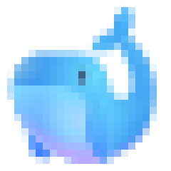
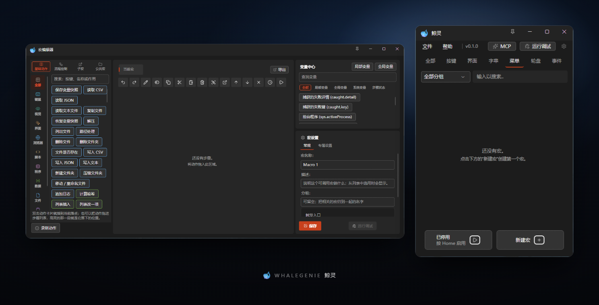

  

<h1 align="center">WhaleGenie（鲸灵）</h1>

<strong>Windows 上的宏与自动化工具</strong>

  
  
  

  
  
  

  <a href="https://github.com/ilpoint/WhaleGenie/releases/latest">下载最新版</a> ·
  <a href="docs/manual.md">使用说明</a> ·
  <a href="https://ilpoint.github.io/WhaleGenie/">项目介绍页</a> ·
  <a href="https://qm.qq.com/q/bqAuMuml4A">QQ 群</a>

---

WhaleGenie（鲸灵）是 Windows 上的宏与自动化工具：键盘、鼠标、手柄、屏幕与窗口上的操作可以按顺序
编成一条宏，由热键、鼠标按键、像素颜色、窗口或进程出现触发。界面由 Avalonia 窗口承载 WebView2 + Lit 页面，执行引擎与界面分离。

## 界面

  

主界面选择并启停宏，宏编辑器按执行顺序编排步骤，动作编辑器只修改选中的那一步。三个窗口共用一套
操作方式；更完整的界面预览见[项目介绍页](https://ilpoint.github.io/WhaleGenie/)。

## 功能

| 能力 | 说明 |
| --- | --- |
| 输入与触发 | 键盘按键，鼠标按键、移动与滚轮，手柄按键与摇杆；前台、后台消息和驱动级虚拟 USB 三种输入方式。一个宏可以绑定多个入口。 |
| 画面识别 | 找图（四种算法）、找色与颜色占比、多点找色、画面静止、屏幕取字和取色；内置 YOLO 检测，识别后可点击图片或文字。 |
| 窗口与元素 | 按标题、进程名或窗口类名定位窗口，移动、缩放、置顶、显示或隐藏，读取窗口与客户区矩形；通过 UI Automation 读取和操作控件。 |
| 浏览器 | 打开页面、点击元素、填写表单、读取文字和属性、截图、切换或关闭标签页；默认使用系统自带的 Edge。 |
| 文件与数据 | 读写文本、CSV 和 JSON，使用剪贴板（含图片），操作文件夹和进程，执行命令行或脚本。 |
| 流程与调试 | 循环、分支、尝试与收尾、子宏调用；支持断点、单步、识别结果、步骤状态和运行日志。 |
| 录制与拾取 | 录制键鼠操作并生成步骤；提供图片、窗口、元素、颜色、区域、按键、手柄和变量八种拾取器。 |
| 编辑与保存 | 四类动作库拖放编排，父宏可以携带子宏文档，本机公共宏库按版本复制；容器块可折叠；`.wgmacro` 连同图片打包；未保存内容有崩溃恢复快照。 |

## 快速开始

1. 从 [Releases](https://github.com/ilpoint/WhaleGenie/releases) 下载压缩包。`WhaleGenie-<版本>-win-x64.zip`
   是框架依赖包，需要 .NET 10 桌面运行时；`...-standalone.zip` 自带运行时，不需要预装。
2. 解压后得到 `WhaleGenie` 文件夹，`WhaleGenie.exe` 位于最外层，双击运行。
3. 首次启动会跟随 Windows 显示语言。想先了解用法，可以用「录制动作」录一条简单的宏，再回到编辑器修改。

## 系统要求

- Windows 10 2004（内部版本 19041）或 Windows 11，64 位。
- 界面支持中文和英文，首次启动跟随 Windows 显示语言，可在设置中切换。
- 框架依赖包需要 .NET 10 桌面运行时。MCP 使用标准输入输出，不依赖 ASP.NET Core；自带运行时包不需要额外安装。

Windows 10 2004 是 Graphics Capture 的最低版本。更早的系统会改用其他画面获取方式（见
[使用说明](docs/manual/13-capture-and-detection.md#画面从哪来怎么取)中的「画面从哪来、怎么取」），程序仍可运行。

## 社区与反馈

| 渠道 | 用途 |
| --- | --- |
| [QQ 群](https://qm.qq.com/q/bqAuMuml4A) | 安装、配置和使用问题，以及需求讨论；中文交流最快。 |
| [GitHub Issues](https://github.com/ilpoint/WhaleGenie/issues) | 可复现的缺陷和明确的功能请求，便于跟踪和归档。 |

提问时请附上版本、Windows 版本、动作和失败键。涉及画面识别时，再附一张截图和参考图，定位会更快。

## 文档

| 文档 | 内容 |
| --- | --- |
| [docs/manual.md](docs/manual.md) | 使用指南：宏包格式、拾取器、返回值、运行调试、画面获取与文件位置 |
| [docs/dev.md](docs/dev.md) | 开发入口：环境、动作修改、字段命名、测试、验收与发布 |
| [DESIGN.md](DESIGN.md) | 界面规范：视觉基调、令牌、窗口框架与验收方式 |
| [docs/architecture.md](docs/architecture.md) | 项目结构：工程划分、依赖方向、子系统与已知限制 |
| [docs/roadmap.md](docs/roadmap.md) | 后续计划：未完成阶段、可并行事项与暂不实现的范围 |
| [THIRD-PARTY-NOTICES.md](THIRD-PARTY-NOTICES.md) | 第三方组件与图标出处 |
| [项目介绍页](https://ilpoint.github.io/WhaleGenie/) | 功能概览、界面预览与 24 秒介绍短片 |

## 打赏支持

WhaleGenie（鲸灵）是完全免费的开源项目。如果你觉得它对你有帮助，欢迎请🐋吃白饭🍚。

<table>
  <tr>
    <td align="center"></td>
    <td align="center"></td>
  </tr>
  <tr>
    <td align="center">微信</td>
    <td align="center">支付宝</td>
  </tr>
</table>

## 许可与致谢

程序按 AGPL-3.0 发布，条款原文见 [LICENSE.txt](LICENSE.txt)，版权归 ilpoint 所有，署名见 [NOTICE](NOTICE)。
两份文件随发布包分发，对应源码为本仓库。图标来自 Emojiall 的像素风鲸鱼 emoji，按 CC BY 4.0 使用，
已缩放并修改。

项目使用以下开源组件，第三方说明见 [THIRD-PARTY-NOTICES.md](THIRD-PARTY-NOTICES.md)：

  
  
  
  
  
  
  
  
  

