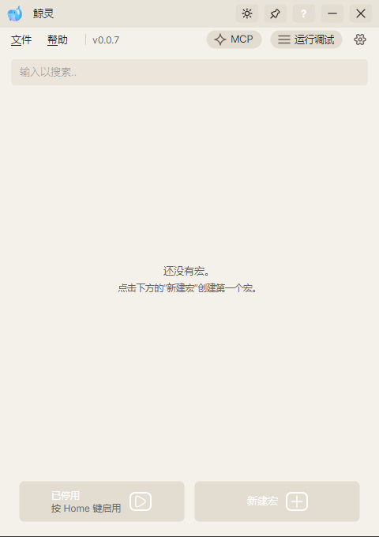
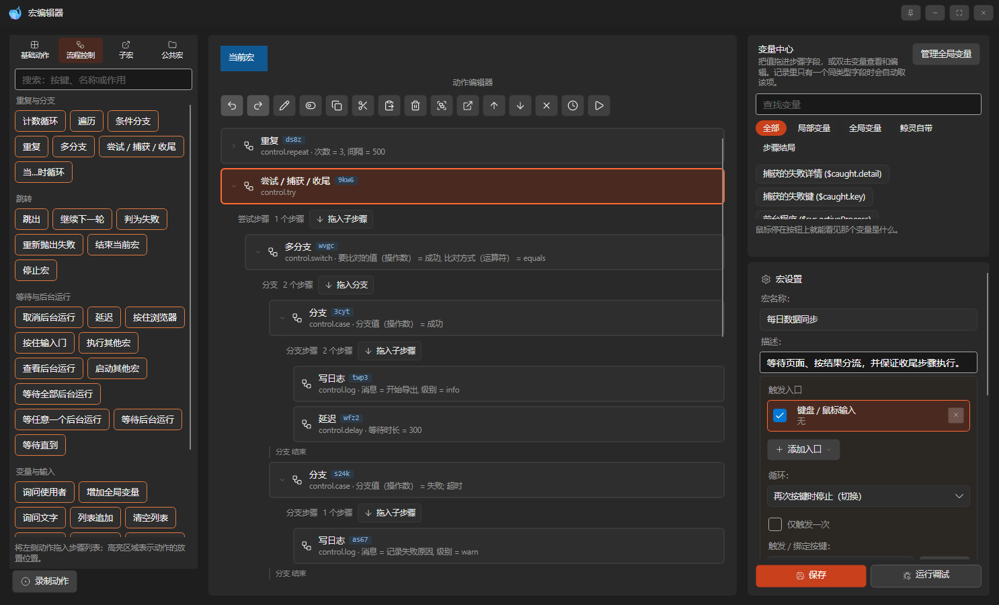

# WhaleGenie（鲸灵）

[-0078D4?logo=windows&logoColor=white)](https://www.microsoft.com/windows)

Windows 通用宏与自动化工具。将键盘、鼠标、手柄、屏幕与窗口操作编排为宏，由热键、鼠标按键、
滚轮、像素颜色、窗口或进程出现触发；同一宏还可以拥有窗口悬浮按钮、键盘字串和
Quicker 风格菜单入口。界面基于 Avalonia，执行引擎与界面分离。

## 界面

<table>
  <tr>
    <td align="center"></td>
    <td align="center"></td>
  </tr>
  <tr>
    <td align="center">主界面</td>
    <td align="center">宏编辑器</td>
  </tr>
</table>

## 能做什么

| 能力 | 说明 |
| --- | --- |
| 输入与触发 | 键盘、鼠标、手柄的按键、移动与滚轮；前台、后台消息与驱动级虚拟 USB 三种输入方式；一个宏可同时拥有按键、颜色、窗口悬浮、字串、菜单和原有定时/文件/程序/窗口/空闲入口 |
| 画面识别 | 找图（四种算法）、找色与颜色占比、多点找色、画面静止、屏幕取字、取色；内置 YOLO 模型检测、等待与点击；识别成功后点击图片或文字 |
| 窗口与元素 | 按标题、进程名或窗口类名识别窗口；移动、缩放、置顶、显示或隐藏，读取窗口与客户区矩形；UI Automation 的取值、选择、勾选、展开与表格读取 |
| 浏览器 | 打开页面、点击元素、填写表单、读取文字与属性、截图、切换与关闭标签页；默认使用系统自带 Edge |
| 文件与数据 | 读写文本、CSV 与 JSON；剪贴板（含图片）；文件夹与进程；命令行与脚本 |
| 流程与调试 | 循环、分支、尝试与收尾、子宏调用；断点、单步、识别结果、步骤结局与运行日志 |
| 录制与拾取 | 录制键鼠操作并生成步骤；图片、窗口、元素、颜色、区域、按键、手柄、变量八种拾取器 |
| 编辑与保存 | 四类动作库拖放编排，父宏可携带子宏文档，本机公共宏库按版本复制；容器块可折叠；`.wgmacro` 连同图片打包；未保存内容有崩溃恢复快照 |

## 需要什么

- Windows 10 2004（内部版本 19041）或 Windows 11，64 位。
- 界面提供中文与英文；首次启动跟随 Windows 显示语言，可在设置中切换。
- 框架依赖包需要 .NET 10 桌面运行时与 ASP.NET Core 运行时（后者供本机 MCP 服务使用）；
  自带运行时包无需预装。

Windows 10 2004 是 Graphics Capture 的最低要求。更早的系统会退回其他画面获取方式
（见[使用说明](doc/manual.md)中的「画面从哪来、怎么取」），程序仍可运行。

从 [Releases](https://github.com/ilpoint/WhaleGenie/releases) 下载。解压后为 `WhaleGenie` 文件夹，
`WhaleGenie.exe` 位于最外层，双击运行。

## 文档

| 文档 | 内容 |
| --- | --- |
| [doc/manual.md](doc/manual.md) | 使用程序：宏包格式、拾取器、落点与落手、返回值、运行与调试、画面获取、CSV 与程序文件位置 |
| [doc/dev.md](doc/dev.md) | 修改仓库：命令、工程结构、依赖、测试分层、性能测量、代码约定、提交与发布 |
| [doc/roadmap.md](doc/roadmap.md) | 后续计划：未完成阶段、可并行的零散项、明确不做的范围 |
| [doc/performance.md](doc/performance.md)（[English](doc/performance.en.md)） | 单次画面读取的单位成本与测量方法 |
| [THIRD-PARTY-NOTICES.md](THIRD-PARTY-NOTICES.md) | 第三方组件与图标出处 |
| [项目介绍页](https://ilpoint.github.io/WhaleGenie/) | 功能概览、界面预览与 24 秒介绍短片 |

## 打赏支持

WhaleGenie（鲸灵）是完全免费的开源项目。如果你觉得它对你有帮助，欢迎请🐋吃白饭🍚。

<table>
  <tr>
    <td align="center"></td>
    <td align="center"></td>
  </tr>
  <tr>
    <td align="center">微信</td>
    <td align="center">支付宝</td>
  </tr>
</table>

## 许可与致谢

程序按 AGPL-3.0 授权，条款原文见 `LICENSE.txt`，版权归 ilpoint 所有，署名见 `NOTICE`。两份文件
随发布包分发，对应源码为本仓库。图标为 Emojiall 的像素风鲸鱼 emoji，按 CC BY 4.0 使用，已缩放并修改。
