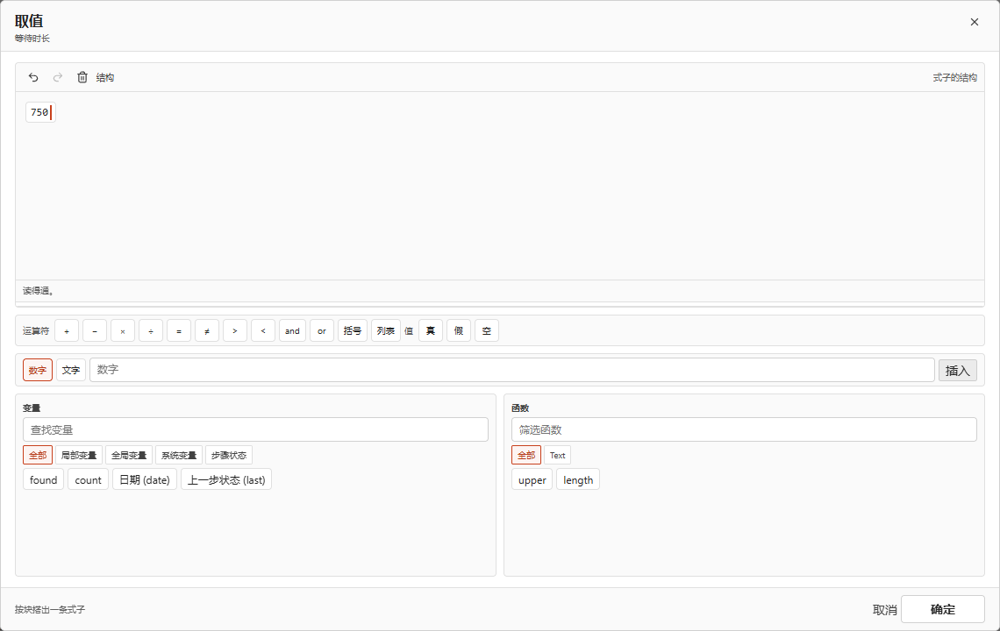

# 取值、文字比较与落点

所属：[WhaleGenie 使用说明](../manual.md)。

## 取值窗口

**一张格子怎么读由字段决定，共有四种，入口只有取值窗口。** 字段本身只读，只负责把值显示成看得懂的
一行——名字说成「名字」，一段话里夹着变量时显示成独立的一枚名字片。窗口按字段的读法分四模式：
**文字**（说明、信）是一整段文本框；**文本**（路径、程序参数）是文字与名字组成的序列，直接打字，
变量点进来就是一枚名字片；**整值**（数字、颜色、能写算式的文本）是 token 树，在里面挑变量、点函数、
搭算式；**名字**（写哪个变量）是变量列表，搜索框里输入一个合法的新名字时列表上方出现「新建」一行。
四种模式交回的都是同一份形状，不会因为显示成一行字就变回拼写。
数字框收到读不成数字的文字会当场报 `Run.BadExpression`，不会把它当成 0。其余文本字段里，句中夹带的
名字片在运行时换成变量的值。旧宏或手工键入的一行带 `$` 记号的文字仍能读进来，但那只是兼容入口，
不是写字时该用的语法。
设计期检查按同一套读法找未定义的变量。**数字字段的范围由目录说了算**：超出范围报 `Run.OutOfRange`，不再静默夹到边上。
**超时默认值只有两档**：等屏幕（识图、OCR、控件、页面、窗口，以及写剪贴板）默认 10 秒；等外部的东西
（脚本、程序结束、命令行、等人按键、剪贴板被改写、下载、执行子宏、等待直到）默认 10 分钟。同一档里的动作
用同一个数，不再一个 5 秒一个 15 秒；每个步骤都可以在「其它设置 → 超时」里单独改，填 0 表示不限时。

**必填字段空着**会在运行时报它自己的失败键：路径仍是 `Run.MissingPath`、程序是 `Run.MissingProgram`，没有专门键的报 `Run.MissingField`；只在某种设置下才用得到的字段（例如按文件取哈希时的路径）空着不算错。**选项写了目录没有的词**报它自己的键（`Run.BadMatchMode`、`Run.UnknownPowerAction` 等），没有专门键的报 `Run.BadOption`；窗口的匹配方式与 `browser.switchTab` 的认法是写明的回退，照旧按最旧/最新的读法处理。
**文字与名字各是一片**：在取值窗口里往一段话中间插一个变量，它就是一枚名字片，前后各是一片文字。
`C:\out\` 后面插上 `file`，再接 `.txt`，运行时得到 `C:\out\Ada.txt`；名字到哪里结束由片本身决定，
不再需要花括号去圈住它，也不会把后面的点算进名字。想改哪一片就点哪一片，删掉一枚名字片只带走它自己，
前后两段文字接起来，不留空位。

**算式也在窗口里搭，运算符不是一块兄弟。** 左侧已经有完整值时，点运算符把它包成一条二元表达式：
`3 + ▢` 是一个整体，缺的右操作数在容器内部，不是第四个块；函数参数的空位同理。空公式或光标正在
空位上时没有可包的左值，运算符按钮是灰的。点一块选中它，再点一下或点带子的空白处放下；
选中后点运算符/「括号」/「列表」，作用的是选中的那一块；没选中时作用在光标前的完整表达式或整个根上。根上不会并排出现两个表达式：没有空位时，
值、名字和函数都拒绝写入，窗口说明原因，而不是把半句话存进宏里。函数卡按声明的参数数留出空位；
选中一个值再点函数卡，会把这个值作为它的第一个实参。

**哪些框能写算式，看标签前面那个小 `ƒ`**：带这个标记的字段整段值都是一次算出来的（数字、颜色、
文本都算），没有标记的字段里名字片就地换成值，其余文字照原样使用。字段下面那行小字也写着
这一条。每个能取值的字段里都贴着一枚带字的「取值」小片，点它打开同一个取值窗口：整值字段进去是 token 带，
只写变量名的格子进去是变量列表和新建行，文字字段进去是一整段文本框，文本字段进去是文字与名字的序列。**片在这一格里，不必猜它说的是哪一格**，也不再有两颗按钮分守两边。
多行框（要写出去的一段话、一封信）的片贴在右上角，不跟着框高漂在文字中间。数字框没有上下调节按钮：
右端就是那枚片，数字手打，要算式就点它。**百分比字段（容差、至少占比这类）不摆片**：这些数是拧
出来的，摆一个写公式的入口只会让人多一次犹豫；只手填一个点的窗口也不摆。

**一个窗口，材料同屏。** 结构带独占上方一条，下面是符号、变量、函数三盘，一页里同时看得见；写一条
式子不必在页之间来回切。结构带与三盘之间有一条可以上下拖的分隔条，中间那一小条亮杠就是它的把手，指上去
变亮；结构区最少留 200 像素，拖到头就停住，想给三盘腾地方也不会把公式挤没。符号盘里是
运算符、括号、列表和真、假、空三枚值片；紧接着还有一行常驻的小输入框，「数字」与「文本」两枚按钮只切换这一行写什么，
当前那一枚描着强调色。点进输入框直接打字，按「插入」或回车就写进结构带的光标处，插完清空并回到输入框；
回车只插入，窗口不关。输入框按数字的写法收（整数、小数、一个前导负号）；`1e5`、`1,000`、`+5` 都不收，
读不成数时「插入」是灰的。文字自动加引号并转义。变量盘按局部
变量、全局变量、系统变量、步骤状态筛选，函数盘按文本、数字、列表、日期、记录、值与选择分组，两个盘都有
筛选框；每排分类按钮里当前那一类描着强调色，一眼看得出下面列的是哪一组。

**结构带是一棵 token 树，没有整条公式输入框。** 名字、数字、一段文字各是一块；二元和一元是一整个
容器，运算符是容器里的一枚可点按钮，缺的操作数在容器内部；函数是带括号的容器，参数一条条排在容器里，
函数里还能再放函数；列表是 `[ … ]` 一个 token，括号是一对括号包住里面那一块，各自整体移动、整体摘掉。
认不出的字符也照样是一块，半截公式不会变成看不懂的一段。
带子里有一根两像素宽的竖线，一亮一灭地闪，指出下一块材料会写在哪里。竖线只停在真正能写的位置：
普通块的两侧、参数之间、函数末尾的 ghost 和空位上；二元式子内部的操作数之间是结构本身，不再当接缝，
点击中间会落到整条式子的外侧或其中的空位。行尾的竖线在整条式子之后，插入的材料追加到末尾；填完一个
空位后竖线停在新值后面，下一次材料接在它后面，不会反插到前一块。点过带子以后键盘也归它，方向键同样
挪这根竖线：左右跨过一整块，上下跳到相邻行里最近的那一处，竖线走出可见范围时带子自己滚过去；光标还在
搜索框或小输入框里时，方向键仍是挪那一行字。点过带子以后直接敲字母或数字，字符会落进下面那只小输入框，
回车再写进带子；带子本身不是文本框，但键盘不会没有去处。三盘材料和常驻小输入框都写在竖线处，不会替掉
已经写好的块。指针停在一块上时，它的上角露出一枚叉，点叉把这块连同它前后的逗号一起取走；叉只在指针
停着的那一块上出现，指针压在叉上时它转红，其余时候整条式子干干净净。带子有焦点时，退格删除竖线前一块，
Delete 删除后一块；删除文字片或名字片会合拢两侧，删除函数实参会连同逗号一起收掉，函数末尾退格只删最后
一个实参，不会删整条函数；删除二元运算的一侧则保留另一侧。只有还没填完的公式（以及空公式）才显示空位；
那个空位也能用退格收掉。括号和列表不再拆成半对按钮：点「括号」把选中或光标前的表达式包成一组，
点「列表」把它变成列表的第一项，各自是一个整体，能整体移动、整体摘掉。

**参数看得懂。** 容器末尾那个虚线小框是幽灵槽，写进去就再长出一个参数位，写满这个函数要的最多个数就
收起；不必另外手动加空位。实参一个都没有时容器里写「参数为空」。每个参数前面写着它叫什么、是第几个、
必填还是可选；必填而空着用红色虚框标出，指针停上去说明这一格要填什么。参数超过三个，或者一行确实
排不下时，容器自动改成一个参数一行，可选参数另起一行并往里缩，左侧一条细线标出层级；短式子仍排成
一行。参数里套着别的函数不再单独触发展开。一次只展开一层，套在里面的调用保持紧凑，结构带不会被撑得
看不到后半条式子。放不下时结构带可以上下滚，符号与值那条横带、变量与函数两盘都不动。

**拖与落点。** 只有 token 能拖，根和整条文本序列不能；在带子的空白处按下只移动竖线，不会把整条式子拖走。
按住一块拖到另一块上就搬到那里，落左半边是放到它前面，右半边是放到它后面，参数之间自动补逗号，
跨函数也行；括号组和列表也是 token，搬动时仍然是它们自己。一次拖动只记一条历史，松手前就把源位置
合拢，撤销一次就回到原处。拖动时落点画一根竖线，
目标块描一圈淡边，线与环都由松手时真正执行的那份落点算出来；把块拖回它原来站的地方，什么都不发生，
也不画线。拖的时候带子里那根竖线先让开，松手后回来。两块挨在一起不会黏成一块，接缝上需要补一个
空格时会自动补。会把一条读得通的式子拖成读不通的落点不执行，落点线也不画；原本就读不通的式子仍可拖，
免得半截公式卡住。

**读作与校验。** 结构带下面一行说这条公式读不读得通，中文界面还把公式用中文念一遍：
`field(get(sys.clipboard, 0), "月份")` 念作「取【剪贴板】里的【第 1 项】的【月份】字段」。读不通时
这一行变红，出错的那一块描上红边，指针停上去说明原因；「确认」同时变灰，按钮旁写着为什么现在不能
确认，是还没写公式、公式读不通、还是必填参数还空着。修正之后红边与禁用一起解除。没有变量叫这个名字的
那一块也描红边，指针停上去说没有这个名字。整条公式空着时「确认」仍可按；按下去把这一格清空，不必先取消
再回字段里删。

**撤销与离开。** 结构带表头最左两枚图标是撤销与恢复，Ctrl+Z、Ctrl+Y、Ctrl+Shift+Z 同样可用。打字、点
材料、按叉、退格、Delete、拖都记在同一份历史里，一次撤销连同竖线停留的位置一起恢复。焦点在小输入框或搜索框里时，Ctrl+Z 撤的是那一行字，
不是整条公式。第三枚图标把整条公式一次清空，清掉的同样是历史里的一步，
Ctrl+Z 就把它拿回来；公式空着时这枚按钮是灰的。离开只有两条路：右下角的「确认」和 Esc。常驻小输入框
里的回车只插入材料，不关窗；搜索框、列表都不绑回车，双击也不插入并关窗，所以写到一半碰一下回车不会把
正在做的事丢掉。

**函数怎么挑。** 函数盘里的卡片按分组着色，卡片上写中文名和代码名（例如「截取文本 (substring)」）。
点一张卡片就在当前空位插一个空调用；选中一块时，把它作为第一个实参包进去。没有空位时窗口会说明原因，
不会在根上再摆一个兄弟。竖线停在括号内等着填第一个参数。鼠标停在卡片上
会弹出气泡，里面是这个函数的写法、它要几个参数、一句说明，再往下每个参数一行，写着这个参数叫什么、
要放什么进去。筛选框按中文名、代码名或写法找；筛不出东西时列表位置写一行说明。函数一览见后面的
「表达式函数一览」。

**数字框留空是什么意思，同样写在字段下面。** 留空的含义由动作目录声明，只有五种：区域那一族的
四个数留空是从这条边一直量到屏幕边缘（或量到目标窗口客户区的那一边），四个都留空就是整块屏幕；移动或调整窗口大小
的四个数留空是保持窗口当前的位置或大小，只填这一步要改的那几项；等待时看屏幕的「查看间隔」留空是
按屏幕刷新一次的时间看；有默认值的数字留空按那个默认值；坐标、时长这类留空就是 0。
区域那四个数从哪里量起，写在同一段下面的那行小字里（屏幕 / 窗口）。
写进数字框的算式是**跑起来的时候**算的：算不出来（名字不存在、内容形状对不上、除以 0）这一步判失败
并说明原因，不会悄悄按 0 接着走；写宏的时候只标当场就能确定的问题（算式没写完、名字或函数不存在），
像 `field(hit, "x")` 这种要从记录里取值、跑过才知道答案的写法，下面那行只提示"要跑起来才知道"。

**键鼠动作的「输入方式」是第一行。** 前台与驱动级按屏幕坐标发输入；后台消息紧接一条窗口规则，
窗口的 X、Y 从客户区左上角算起。后台会隐藏「用指针当前位置」和「点完移回」两项，缺窗口时报
`Run.MissingTargetWindow`；相对移动只提供前台与驱动级，不提供后台。后台键盘消息投给目标窗口
所属线程当前的焦点控件；焦点为空时改用最近一次后台点击的子控件，或能回答“需要字符输入”的子控件。
鼠标和滚轮投给坐标下最深的可见子控件，因此标准编辑框、列表和按钮也会收到消息，而不是只到顶层窗口。
键盘动作前先用后台鼠标点一下目标输入框最稳妥。Windows 拒绝投递时报 `Run.BackgroundPostFailed`，
不再静默跳过。

选择器旁边有一个「测试」，用来在写宏的时候当场确认选的是不是它：把它在屏幕上高亮一下
（`uia.*` 的边框、页面里元素的闪烁），**不点它**——验的是"选中了是不是它"，真点下去会把用户
的东西弄乱。

按键、组合键与手柄控件不再各有一颗「测试」：那几颗按钮做的正是"按现在这一步跑一次"，与表单
下方的运行按钮是同一件事，留着只是让同一页上有两个入口。要试它们，按「运行」即可：它把这一步
真的发出去，按这一步自己的输入方式走（前台 / 后台消息 / 驱动级），手柄是按一下、拨一下或扣一下，
随后自动松开；按之前对话框会让开，好让你在目标窗口或游戏里看一眼对不对。

试的就是**这一步本身**（按关掉对话框后会存下来的那份设置跑），而且只跑这一步：引擎里
`StepTrial.TryAsync` 走的是和运行宏同一套代码，跑完把还按着的东西松开。

## 怎么比文字

凡是"拿一段文字去比另一段"，程序里用的都是同一批词，五档：

| 档 | 宏文件里写的 | 什么时候算比中 |
| --- | --- | --- |
| 包含（默认） | `contains` | 要查找的那段出现在被比的文字里 |
| 以…开头 | `startsWith` | 被比的文字从要查找的那段开始 |
| 以…结尾 | `endsWith` | 被比的文字到要查找的那段结束 |
| 等于 | `equals` | 两段一样；比之前两端多出来的空格都去掉 |
| 正则匹配 | `regex` | 要查找的那段当正则表达式用 |

五档默认**忽略大小写**。高级设置里的「区分大小写」打开后，五档都按原样比较；它不影响空格。
「等于」默认先去两端空格，因为屏幕上读到的字常带着边上那点空隙，而照着手打一遍不会有。要去掉这层
默认，关掉「去掉两端空格」即可；这个开关只在要求两段文字相同时出现（含「不等于」），默认开。正则档另有「正则按行」，默认关，
打开后 `^` 与 `$` 按每一行算。这一格留空是"没说"，按「包含」走。手写的宏文件里写了这五个词以外的
字，这一步**失败**并报出原因（`Run.BadMatchMode`），不会在背后换成另一种比法。

所有正则（比较、表达式里的 `matches` / `replace` / `split`、OCR 的 `expected`）共用一秒的执行上限。
一秒内没有算完的，这一步报 `Run.RegexTimeout` 并说出是哪一段模式，失败策略照常生效；不会让整个运行
卡在回溯里。

用同一批词的地方：找文字、点击文字的**「匹配方式」**；
**窗口那格「匹配方式」**有十档：标题五档齐备，「进程名」「窗口类名」各两档（包含 / 等于），
再加“窗口句柄（当前实例）”。所以"进程名正好是 notepad"写得出，`notepad` 也不会再命中 `notepad++`；
同标题同进程的双开可以用句柄只认其中一扇，窗口关闭后这一档会报找不到，不会改认另一扇；
「多分支」（`control.switch`）、「读取 CSV」（`file.readCsv`）的文本档与
`browser.waitForUrl` 引用的也是这批字，它们另有「不等于」与大于 / 小于那几档，那是数字的事。
表达式里的 `contains` / `startsWith` / `endsWith` / `match` 与带开关的 `compare` 是函数调用、不是档位，词也照着这一批
对齐。

## 落点与落手

点击类的字段决定的不只是"点哪儿"，还有"怎么落手"。这几个字段在写宏时常常一起考虑：

| 字段 | 在哪 | 什么时候填它 |
| --- | --- | --- |
| **就在指针当前所在位置**（`useCursor`，默认关） | 鼠标点击 / 鼠标双击 / 鼠标按下 / 鼠标松开 / 滚轮 | 位置由用户自己放好的鼠标决定时用它：勾上后这一步不写坐标，运行时在指针当时停留的地方完成。勾上后「X」「Y」不画、不写进宏文件；这一项只在前台与驱动级出现，后台消息不能读屏幕指针。取消勾选时原来填过的值原样回来 |
| **落点随机范围**（`variance`，像素，默认 0） | 鼠标点击 / 鼠标双击 / 点击图片 / 点击文字 / 点击颜色 | 连着点同一处时，不希望每次落在同一个像素上。填了数就每次都在这范围内随机取一点；`0` 是正好落在写的位置。数字要小到整个范围仍在被点的东西里面 |
| **点完把指针移回原处**（`moveBack`，默认关） | 鼠标点击 / 鼠标双击 | 点完之后要把鼠标还回用户自己放的地方，不让它留在游戏画面上。后台模式下屏幕上的指针本来就没动，这个开关不起作用 |
| **到终点先停**（`settleMs`，毫秒，默认 0） | 鼠标拖拽 | 拖到终点后先按住不动一会儿再松开。要拖进格子的东西只有指针在格子上停过一下才会被放进去；`0` 是一到就松 |
| **落手前再确认**（`recheckMs`，毫秒，默认 0） | 点击图片 / 点击文字 | 命中之后要先等一会儿再确认一次，仍认得才点。用于按钮一闪而过、画面其实已经翻过去的情况；`0` 是一认出就点 |

「落手前再确认」的第二次查看只查一次、不再等：等一会儿再看的这一次就是要看它还在不在，画面已经
变过就算没找到。
